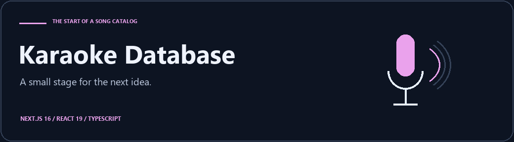

<div align="center">



# Karaoke Database

**A small stage for the next idea.**


[Overview](#overview) &nbsp; · &nbsp; [Run locally](#run-locally) &nbsp; · &nbsp; [Explore the repository](https://github.com/mcampo0215/karaoke_db)

</div>

---

## Overview

An early Next.js scaffold for a karaoke database project. The current home page displays **Welcome to the Karaoke Database**; this repository establishes the app structure and styling toolchain rather than a finished song catalog.

| Start | Build | Extend |
| :--- | :--- | :--- |
| A minimal App Router home page. | Next.js, React, TypeScript, and Tailwind CSS tooling. | A small foundation for future karaoke features. |

## Run locally

Install Node.js and npm, then:

```sh
npm ci
npm run dev
```

Open `http://localhost:3000`.

## Project map

| Source | Responsibility |
| :--- | :--- |
| [app/page.tsx](app/page.tsx) | Current welcome page. |
| [app/layout.tsx](app/layout.tsx) | Root layout and font setup. |
| [app/globals.css](app/globals.css) | Global styling. |
| [package.json](package.json) | Scripts and dependencies. |

## Current scope

Song search, playlists, playback, database persistence, and authentication are not implemented in the current source. The microphone animation is project artwork, not a demonstration of an existing recording feature.

## Development

```sh
npm run lint
npm run build
npm start
```

`npm start` serves the production build after it has been created.

---

<p align="center"><a href="#karaoke-database">Back to the top</a></p>
